# cc-arcade

Games above the Claude Code prompt, for the minutes Claude spends working.

Run `/arcade`, pick a game, and play it right above the prompt while Claude works on your request. When Claude finishes the turn, the game pauses and its status line says so, so you never miss a reply. A pet grows alongside, fed by the tests Claude passes, the commits it makes and the files it edits. Playing costs no tokens: the plugin answers every click and command itself, without asking the model.

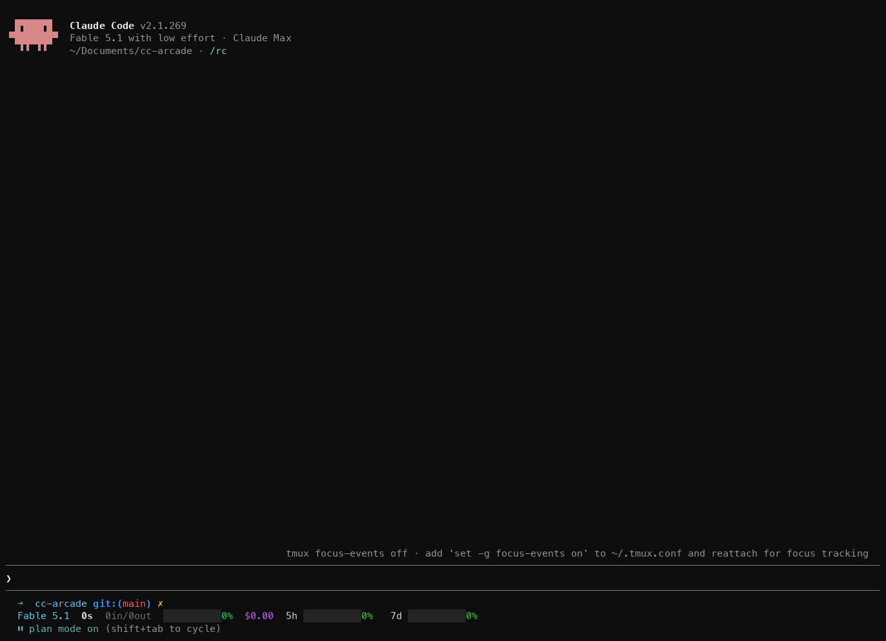

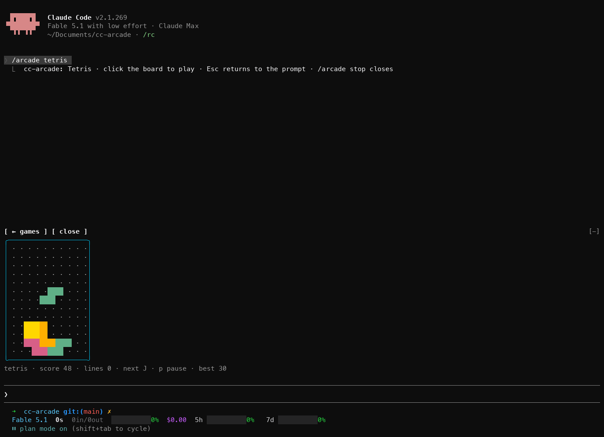

Eight games and a pet: snake, Tetris, 2048, Minesweeper, Flappy, Pong against the computer, a typing test and Space Invaders. Each board has one status line underneath with the score, the controls that matter now and your best score.

The plugin is built on Claude Code **function hooks**: TypeScript that runs inside Claude Code's own process, instead of shell-command hooks. They are in early access, so they need the environment variable the quick start sets, and the API can change between Claude Code releases.

## Requirements

- Claude Code 2.1.269 or later, the first build whose function hooks draw above the prompt, with `CLAUDE_CODE_ENABLE_FUNCTION_HOOKS=1` set. The quick start shows where.
- An interactive terminal session. Nothing draws in `claude -p`, the desktop app or mobile.
- A terminal that reports the mouse. One click is what gives a board the keyboard, and the picker buttons, Minesweeper, Pong and Space Invaders use the mouse too.
- A terminal font with box-drawing and block characters. Modern terminals are fine; the old Windows console draws them as boxes.

## Quick start

1. Turn function hooks on. Add this to `~/.claude/settings.json` (create the file if it does not exist, or merge the `env` key into what is there). Without it the plugin installs fine but does nothing.

   ```json
   {
     "env": {
       "CLAUDE_CODE_ENABLE_FUNCTION_HOOKS": "1"
     }
   }
   ```

   This also loads the hooks module of any other installed plugin that ships one. For a single session instead, prefix the command: `CLAUDE_CODE_ENABLE_FUNCTION_HOOKS=1 claude`.

2. Install from GitHub. The repo is its own marketplace:

   ```sh
   claude plugin marketplace add sezaakgun/cc-arcade
   claude plugin install cc-arcade@cc-arcade
   ```

3. Start `claude` and run `/arcade`. A row of buttons appears above the prompt: one per game, plus `pet`, `random`, `auto` and `close`.

   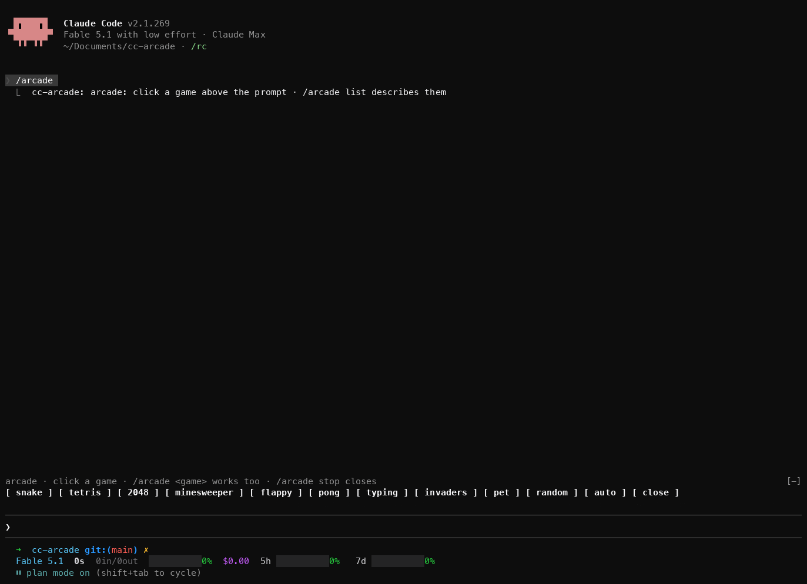

4. Click `snake`. The board appears in place of the buttons.

5. **Click the board**, then press an arrow key. The click gives the game the keyboard; until then your keys go to the prompt.

   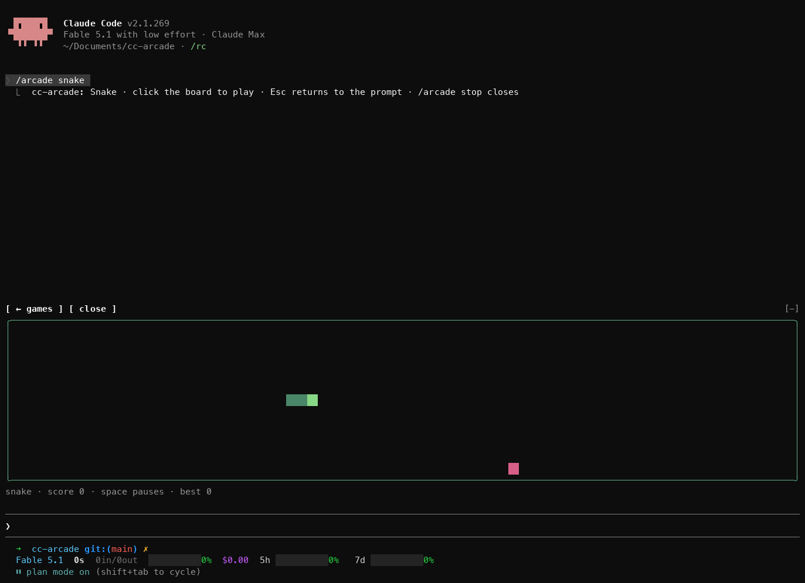

6. Press **Esc** to give the keyboard back to the prompt. Click `← games` above the board to go back to the list, or `close` to close the arcade.

If `/arcade` is an unknown command, see [Troubleshooting](#troubleshooting).

To remove it:

```sh
claude plugin uninstall cc-arcade
claude plugin marketplace remove cc-arcade
```

To try it without installing, or to hack on it, clone and load it for one session:

```sh
git clone https://github.com/sezaakgun/cc-arcade
cd cc-arcade
claude --plugin-dir .
```

The repo's own `.claude/settings.json` sets the variable for sessions started inside the folder, which also loads any other installed plugin's hooks module there.

## Use

- **Pick a game**: run `/arcade` and click one, or name it directly: `/arcade tetris`.
- **Let it choose**: `/arcade random` starts any game except the pet and the one you just played. `/arcade auto` picks one for the moment; see [Auto](#auto).
- **See the games and your best scores**: `/arcade list`.
- **Back to the list**: click `← games` above the board. The picker comes back and the game you left stops.
- **Switch games**: pick another from the list, or run `/arcade <game>`. One game is open at a time.
- **Close**: click `close` above the board or in the picker, or run `/arcade stop`.

Every form of `/arcade` runs straight away, even while Claude is working.

## Games

WASD mirrors the arrows in every game that uses them.

- **`snake`**: arrows steer, Space or `p` pauses, `r` restarts. Eat the red food, keep off the walls and your own tail.
- **`tetris`**: ← → move, ↑ or `x` rotates, ↓ drops one row, Space drops to the bottom, `p` pauses, `r` restarts. The pieces fall faster every ten lines.
- **`2048`**: arrows slide every tile, `r` restarts. Equal tiles merge; the game ends when no slide changes anything.
- **`minesweeper`**: click a cell to open it, right-click to flag it. Without a mouse: arrows move the blue cursor, Space or Enter opens, `f` flags. `r` deals a new board. The first click never hits a mine.
- **`flappy`**: Space, ↑, `w`, Enter or a click flaps. `p` pauses, `r` restarts. Touching the ceiling only stops you; the floor and the pipes end the round.
- **`pong`**: ↑ ↓, or move the mouse over the board, to place your paddle on the left. Space pauses, `r` restarts. First to 5 wins.
- **`typing`**: type the line shown. Correct characters turn green; a wrong one shows on red until you backspace it. Tab skips to another line, Enter starts the next one after a finished line. Only keys the terminal delivers count, so pasting is no shortcut.
- **`invaders`**: ← → or the mouse move the ship, Space, ↑ or a click fires. `p` pauses, `r` restarts. One shot at a time, three lives, and each cleared wave starts a row lower, up to three rows, and steps faster.

| | |
|---|---|
| 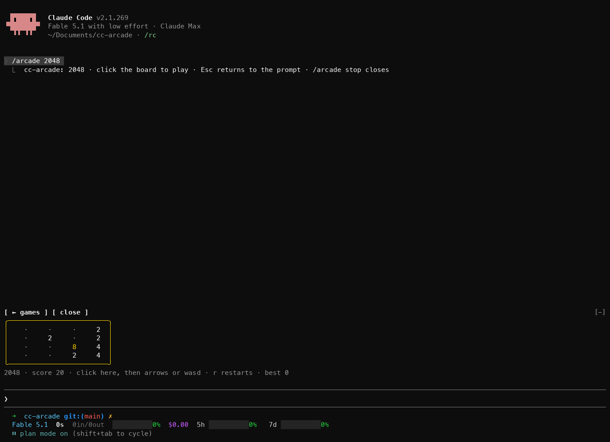 | 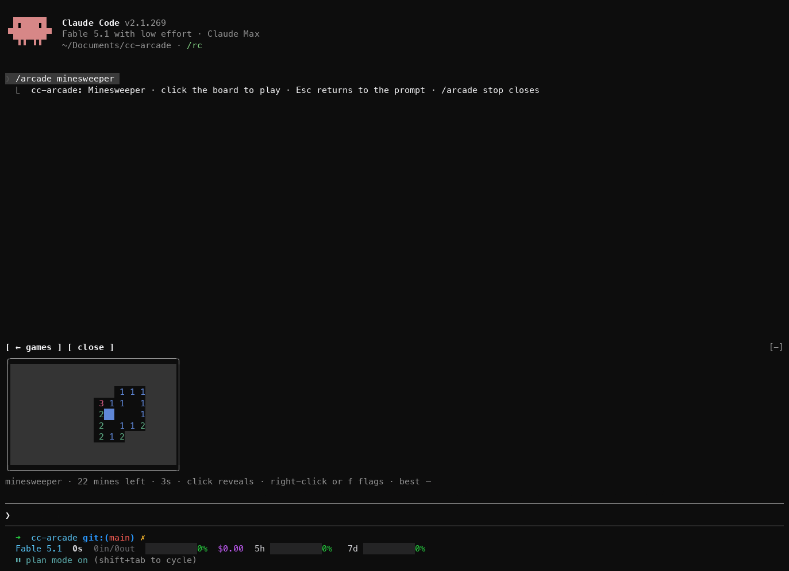 |
| 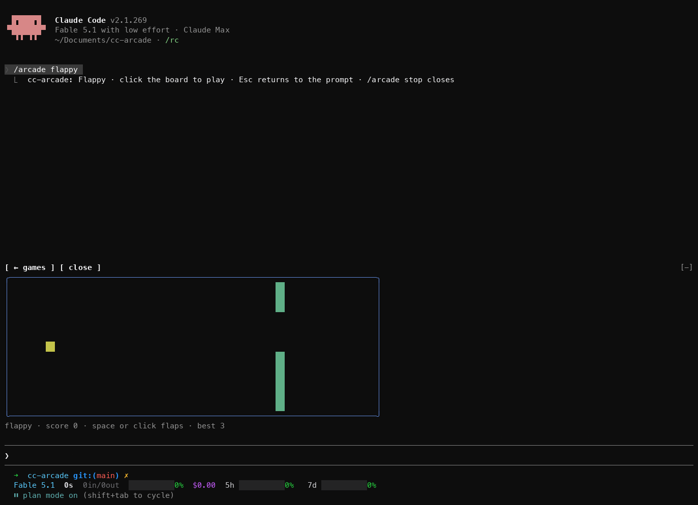 | 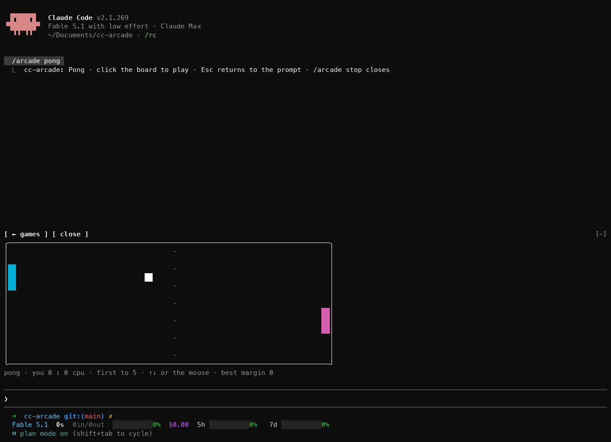 |
| 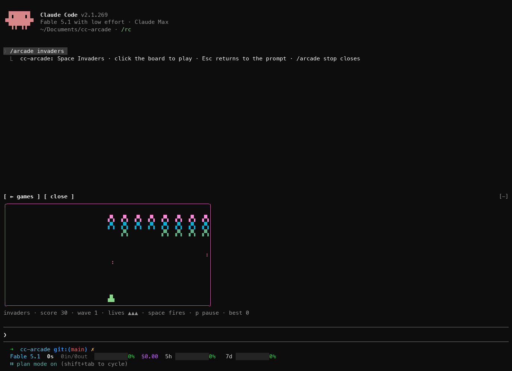 | 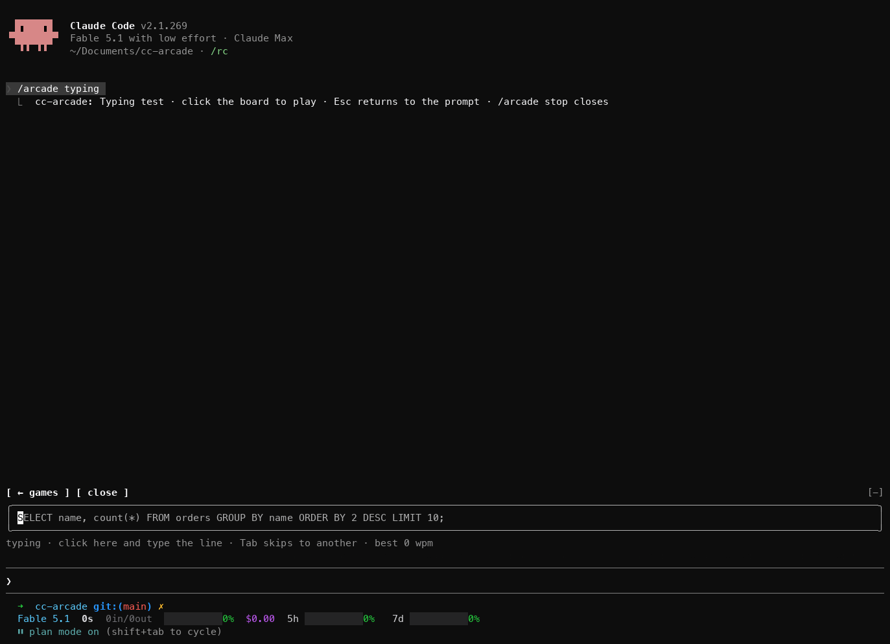 |

These are clones of the genre, not affiliated with or endorsed by Tetris Holding, Taito or Atari.

## Playing while Claude works

Send your prompt, then open a game. When the turn finishes, the open game pauses and its status line turns yellow and starts with `● Claude is done`. Press a key in the game to carry on, or Esc to go and read the reply. The pet has no status line, so it shows no banner.

The board takes the rows above the prompt that Claude Code gives plugins, about half the terminal height. A taller terminal gives bigger snake, Tetris, Flappy, Pong and Invaders boards.

## Auto

`/arcade auto`, or `auto` in the picker, looks at the moment and picks from a small group:

- **The last thing Claude did was fail a test run, under five minutes ago**: `pet`, to check on it.
- **Claude has been on this turn for a minute or more**: `tetris`, `invaders` or `snake`, something to sink into.
- **Claude is working, under a minute so far**: `flappy`, `pong` or `typing`, a quick round.
- **Claude is idle**: `2048` or `minesweeper`, games you can put down any time.

Within the group it picks at random and avoids the game you just played. The reply says why, for example `2048 (auto: Claude is idle, a game you can put down any time)`.

## The pet

`/arcade pet` shows a pet that grows with the work Claude does, in every session with the plugin loaded. You do not play it; it watches Claude's tool calls. Click it and it shows hearts.

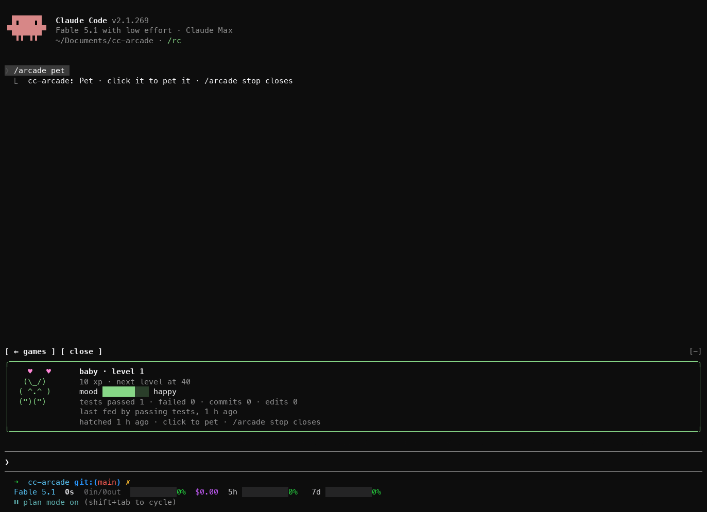

- **A test run that passes** gives +10 XP and lifts its mood by 8. Recognised runners: `bun test`, `npm test`, `pnpm test`, `yarn test`, `pytest`, `go test`, `cargo test`, `jest`, `vitest`, `mocha`, `rspec`, `phpunit`, `make test`, and `test` tasks of `mvn`, `gradle`, `gradlew` and `sbt`, also through `npx`.
- **A test run that fails** gives +2 XP but costs 12 mood.
- **A `git commit` that succeeds** gives +15 XP and 10 mood. A `--dry-run` does not count.
- **A file edit** through Claude's `Edit`, `Write` or `NotebookEdit` gives +1 XP and 1 mood.

Level *n* needs 10·*n*² XP. The pet hatches at level 1, becomes a kid at 3, an adult at 6 and a legend at 10, and a toast marks each level. Its mood is happy from 70, okay from 35 and sad below; with no work it sinks a point every ten minutes until it is bored at 30, and only failing tests take it lower.

The pet is kept in the plugin's store, so every session feeds the same one and it survives restarts. Commands you run yourself in a terminal do not count; only Claude's tool calls do.

**What the pet sees.** To feed it, the plugin hooks every tool call in sessions where it is loaded, which means it sees each Bash command's text and whether the call failed. It matches that text against the list above and keeps counters only: no command text, file path or prompt is stored or logged. The plugin makes no network calls of any kind; the pet and your best scores stay in Claude Code's plugin store on this machine.

## Best scores

Each game keeps its best score across sessions, and a new best shows a toast. `/arcade list` shows them all.

- **snake**: most food eaten
- **tetris**: highest score, with 100, 300, 500 or 800 for clearing 1 to 4 lines at once and 2 per row dropped with Space
- **2048**: highest score when no slide is left
- **minesweeper**: fastest clear, in seconds
- **flappy**: most pipes passed
- **pong**: biggest margin you won by
- **typing**: fastest finished line, in words per minute at five characters a word
- **invaders**: highest score, 10 per alien

## How it works

- `hooks/register.tsx` is the hooks module. It registers `/arcade` and draws the picker or the open board above the prompt. It keeps best scores and the pet with `$.store`, times turns for `auto` on `turn.start`, pauses the open game on `turn.complete`, and feeds the pet on `tool.call`.
- `hooks/boards/*.tsx` are surface modules, one per board, mounted as `Client` elements. Each runs on the drawing thread with its own frame clock, keyboard and mouse, and posts a finished round's score back to the hooks module.
- `hooks/games/*.ts` hold each game's rules, the pet, the best-score comparison and the `random` and `auto` pickers as pure functions. The tests cover them.

## Troubleshooting

- **`/arcade` is an unknown command.** Function hooks are off. Check `CLAUDE_CODE_ENABLE_FUNCTION_HOOKS` is set in `~/.claude/settings.json` under `env` (see Quick start), and that the plugin is loaded with `/plugins`.
- **Keys go to the prompt instead of the game.** Click the board first. Esc hands the keyboard back to the prompt.
- **Nothing happens when you click.** Your terminal does not report the mouse. `/arcade <game>` still opens a game, but a board cannot get the keyboard without a click.
- **The board is small.** Claude Code gives the area above the prompt about half the terminal. Make the terminal taller.
- **A board is replaced by one line naming the plugin and the module.** The board threw an error or ran over its time budget and was unmounted. Run `/arcade stop` and open it again. If it repeats, start Claude with `--debug-file /tmp/cc-arcade.log` and search the log for `cc-arcade`.
- **The pet does not grow.** Only Claude's tool calls feed it, and only the commands listed in [The pet](#the-pet).
- **Games stopped working after editing the plugin.** A hot reload that fails partway leaves the old version loaded. Restart the session.

## Limits

- The animated boards redraw ten times a second, so fast games feel coarse next to a real console. 2048 and Minesweeper are turn-based and the pet redraws five times a second.
- One game is open at a time, in about half the terminal height.
- A game only gets the keyboard after a click, and never gets Esc, which always returns to the prompt.
- A headless `claude -p` run, the desktop app and mobile never draw the arcade.
- Best scores and the pet live in the plugin's store on this machine. Nothing is shared between machines.

## Develop

From the repo root:

```sh
bun test                                            # game rules, the pet, best scores, random and auto
claude plugin validate .claude-plugin/plugin.json   # lists the hooked events, $ calls and surface modules
claude plugin validate .                            # checks the marketplace manifest
```

`bun test` is the only check that works on a bare clone, and CI runs it on every push. Type checking needs the early-access types: open a Claude Code session in this folder with function hooks on, run `/plugin-types` (it writes the git-ignored `.claude/types/`), then:

```sh
bunx -p typescript tsc -p .
```

Two rules for board files: never name a local variable `h`, because every JSX tag compiles to a call of `h` and a local `h` breaks the board at its first draw; and write `Client` module paths as string literals, because the engine reads them off the source.

Edits hot-reload into a running session. If a reload fails partway, the transcript says so; restart the session.

## License

MIT. See [LICENSE](LICENSE).
